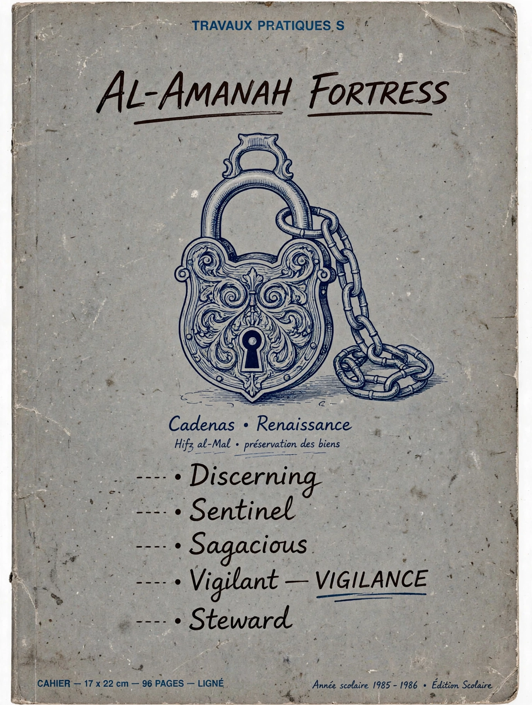

# AL-AMANAH FORTRESS
### TRAVAUX PRATIQUES S - 1985 → 2026 - Batna
**Cadenas • Renaissance - Hifz al-Mal - حفظ المال وصرفه في موضعه**

From my school notebook to a Renaissance lock guarding NEAR

## The Six Guardians
- Al-Amin: The Custodian
- Al-Fatin: The Discerning
- Ar-Ra'i: The Sentinel  
- Al-Kayyis: The Sagacious
- An-Nabih: The Vigilant - VIGILANCE - Cadenas LOCKED
- Al-Qa'id: The Steward - Sarfuhu fi Mawdi'ihi

## Demo
VULNERABLE → FROZEN by The Vigilant
FIXED → RELEASED by The Steward

Built by SIFI BOUKHARI - Batna, DZ - NEAR Hackathon - Nov 14, 2026

**العلامة الكاملة - 20/20**
**العلامة الكاملة — 20/20**
